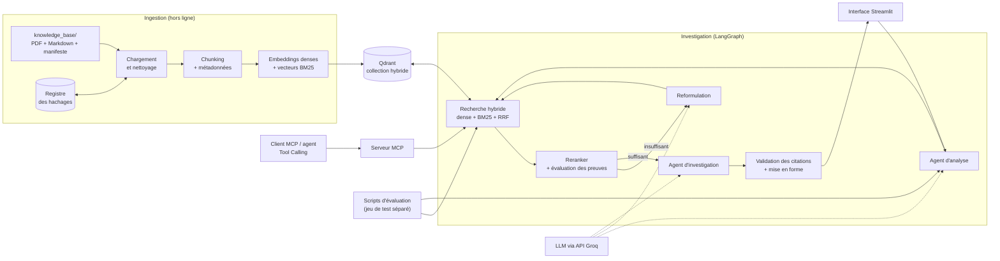
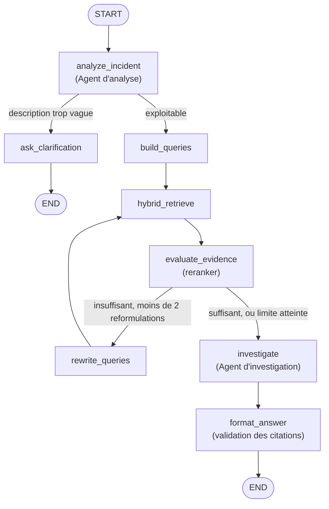

# Cahier des charges — DevOps Incident Investigation Assistant

| | |
|---|---|
| **Cours** | AI Engineering |
| **Équipe** | _[noms des membres]_ |
| **Version** | 1.1 — novembre 2026 |
| **Date de rendu** | _[à compléter]_ |
| **Statut** | Architecture validée par l'équipe ; document soumis au professeur |

> Ce document décrit ce que nous allons construire. **Aucune fonctionnalité logicielle n'est encore implémentée.** À ce stade, nous avons réalisé :
> - l'étude des laboratoires du cours ;
> - l'audit complet du corpus PDF (sections 2 et 23) ;
> - le manifeste du corpus (`knowledge_base/manifest.yaml`), qui indique pour chaque PDF s'il est retenu ou exclu, et pourquoi ;
> - la configuration du dépôt Git ;
> - une fiche Markdown pilote (*Kubernetes Pod in CrashLoopBackOff*), en attente de validation.
>
> Tout le reste est prévu, et décrit au futur.

---

## Sommaire

1. [Présentation du projet](#1-présentation-du-projet)
2. [Contexte et problématique](#2-contexte-et-problématique)
3. [Besoin identifié](#3-besoin-identifié)
4. [Objectifs généraux et spécifiques](#4-objectifs-généraux-et-spécifiques)
5. [Solution proposée](#5-solution-proposée)
6. [Fonctionnalités principales](#6-fonctionnalités-principales)
7. [Utilisateurs ciblés](#7-utilisateurs-ciblés)
8. [Architecture générale](#8-architecture-générale)
9. [Rôle de LangChain](#9-rôle-de-langchain)
10. [Rôle de LangGraph](#10-rôle-de-langgraph)
11. [Fonctionnement des agents](#11-fonctionnement-des-agents)
12. [Pipeline RAG](#12-pipeline-rag)
13. [Stratégie de chunking](#13-stratégie-de-chunking)
14. [Gestion des métadonnées](#14-gestion-des-métadonnées)
15. [Recherche sémantique](#15-recherche-sémantique)
16. [Recherche lexicale BM25](#16-recherche-lexicale-bm25)
17. [Hybrid Retrieval et fusion des résultats](#17-hybrid-retrieval-et-fusion-des-résultats)
18. [Gestion des citations et des sources](#18-gestion-des-citations-et-des-sources)
19. [Tool Calling et serveur MCP](#19-tool-calling-et-serveur-mcp)
20. [Interface Web](#20-interface-web)
21. [Stratégie d'évaluation et de benchmarking](#21-stratégie-dévaluation-et-de-benchmarking)
22. [Choix technologiques et justification](#22-choix-technologiques-et-justification)
23. [Données nécessaires et leur provenance](#23-données-nécessaires-et-leur-provenance)
24. [Limites prévisibles](#24-limites-prévisibles)
25. [Organisation des étapes de réalisation](#25-organisation-des-étapes-de-réalisation)
26. [Livrables attendus](#26-livrables-attendus)

**Glossaire rapide**

- **LLM** (*Large Language Model*) : modèle de langage génératif, appelé ici via une API.
- **RAG** (*Retrieval-Augmented Generation*) : technique qui consiste à rechercher des passages dans une base documentaire, puis à les fournir au LLM pour qu'il fonde sa réponse sur eux plutôt que sur sa seule mémoire.
- **Chunk** : fragment de document (quelques centaines de mots), unité de base de l'indexation et de la recherche.
- **Embedding** : vecteur numérique qui représente le sens d'un texte. Deux textes proches par le sens ont des vecteurs proches.
- **BM25** : fonction de score classique de la recherche par mots-clés, fondée sur la fréquence des termes et leur rareté dans le corpus.
- **RRF** (*Reciprocal Rank Fusion*) : méthode qui fusionne plusieurs classements en ne tenant compte que des rangs.
- **Reranker** : modèle qui relit chaque couple (question, passage) et lui attribue un score de pertinence plus fin que celui de la recherche initiale.
- **MCP** (*Model Context Protocol*) : protocole ouvert qui permet à une application compatible (client) d'utiliser les outils exposés par un serveur.

---

## 1. Présentation du projet

Le **DevOps Incident Investigation Assistant** est un assistant qui aide un ingénieur à investiguer un incident technique dans un environnement DevOps ou Cloud. L'utilisateur décrit son problème avec ses propres mots, par exemple :

- *« An API returns HTTP 502 after a deployment. »*
- *« A Kubernetes pod is stuck in CrashLoopBackOff. »*
- *« Terraform fails because the state is locked. »*

L'assistant analyse la description et identifie les technologies et les symptômes en jeu. Il recherche ensuite les passages pertinents dans une base documentaire et en déduit des causes possibles, une démarche d'investigation et des pistes de résolution. Chaque affirmation importante renvoie à une source précise : document, page ou section.

L'assistant **n'a accès à aucun environnement réel**. Il ne lance aucune commande et n'inspecte aucun cluster ni aucun serveur. Il raisonne uniquement à partir de la description fournie et des documents indexés, et il le dit explicitement dans ses réponses.

## 2. Contexte et problématique

Face à un incident, un ingénieur DevOps doit relier un symptôme souvent vague (« le service ne répond plus ») à une cause technique précise : un sélecteur de Service Kubernetes erroné, un verrou d'état Terraform resté actif après un job interrompu, un groupe de sécurité AWS qui bloque un port. L'information utile existe, mais elle est dispersée entre plusieurs documentations officielles, des ouvrages techniques et l'expérience des équipes.

Un LLM généraliste interrogé directement pose deux problèmes dans ce contexte :

1. **Il ne cite pas ses sources.** L'utilisateur ne peut pas vérifier la réponse ni approfondir.
2. **Il peut affirmer avec assurance une cause non fondée**, voire laisser entendre qu'il a « vérifié » quelque chose. En production, une mauvaise piste coûte du temps, et parfois une aggravation de l'incident.

L'audit du corpus mis à notre disposition (105 PDF, détaillé en section 23) a révélé un second problème : **les ouvrages disponibles expliquent bien les technologies, mais traitent peu les pannes concrètes**. Sur les 17 572 pages du corpus, le terme `CrashLoopBackOff` n'apparaît que 13 fois, les messages liés au verrou d'état Terraform 6 fois (dont 5 dans un seul document), et les messages d'échec de résolution DNS 5 fois. Un RAG construit uniquement sur ces livres retrouverait des chapitres d'introduction plutôt que des procédures de diagnostic.

La problématique du projet est donc double : **comment construire un assistant dont chaque conclusion est traçable vers un document**, et **comment constituer une base documentaire réellement adaptée au diagnostic d'incidents**.

## 3. Besoin identifié

| Besoin | Conséquence pour le système |
|---|---|
| Comprendre une description libre, parfois incomplète | Analyse structurée de l'incident (technologies, symptômes, messages d'erreur) et demande de précisions lorsque la description est trop vague |
| Retrouver des messages d'erreur exacts (`ImagePullBackOff`, `AccessDenied`, `x509`) | Recherche lexicale, en plus de la recherche sémantique |
| Retrouver des passages pertinents même quand l'utilisateur n'emploie pas le vocabulaire des documents | Recherche sémantique par embeddings |
| Pouvoir vérifier chaque affirmation | Citations précises (document + page ou section), contrôlées automatiquement |
| Ne pas être induit en erreur | Distinction explicite entre faits documentés et hypothèses, signalement des informations manquantes |
| Mesurer la qualité plutôt que la supposer | Jeu d'évaluation séparé et benchmark reproductible |
| Réutiliser la recherche documentaire depuis d'autres outils | Serveur MCP exposant la recherche et les métadonnées |

## 4. Objectifs généraux et spécifiques

### Objectif général

Concevoir, implémenter et évaluer un assistant d'investigation d'incidents DevOps fondé sur un RAG hybride et un workflow multi-étapes orchestré par LangGraph, dont les réponses sont sourcées et dont la qualité est mesurée sur un jeu de test indépendant.

### Objectifs spécifiques

1. Constituer une base documentaire ciblée : sélectionner les PDF pertinents du corpus existant et la compléter par des fiches de troubleshooting rédigées à partir de documentations officielles, avec références vérifiées.
2. Mettre en place une ingestion incrémentale (PDF et Markdown) avec nettoyage, chunking, métadonnées et détection des documents ajoutés, modifiés ou supprimés.
3. Implémenter une recherche sémantique, une recherche BM25 et leur fusion par RRF, avec prise en compte des métadonnées.
4. Développer deux agents aux responsabilités distinctes, l'analyse de l'incident et l'investigation, coordonnés par un graphe LangGraph avec une boucle de reformulation bornée.
5. Produire des réponses structurées dont chaque citation est validée par rapport aux passages réellement retrouvés.
6. Exposer la recherche documentaire via un serveur MCP fonctionnel, testé avec un client MCP.
7. Proposer une interface Web simple permettant de soumettre un incident et de consulter l'analyse, les causes, les étapes et les sources.
8. Évaluer le système sur au moins 50 incidents : comparer BM25, recherche sémantique et recherche hybride, puis évaluer la qualité des réponses générées.
9. Mener une expérience légère de fine-tuning du modèle d'embeddings et en mesurer l'effet.

## 5. Solution proposée

La solution s'organise en trois blocs.

**Un bloc documentaire hors ligne.** Un script d'ingestion lit les documents du dossier `knowledge_base/`, les nettoie, les découpe en chunks enrichis de métadonnées, puis les indexe dans Qdrant. Chaque chunk y reçoit deux représentations : un vecteur dense pour la recherche sémantique et un vecteur creux BM25 pour la recherche lexicale. Un registre de hachages permet de ne réindexer que ce qui a changé.

**Un bloc d'investigation en ligne**, orchestré par LangGraph. Le premier agent structure l'incident et prépare les requêtes. La recherche hybride retrouve les passages, puis une étape d'évaluation juge s'ils suffisent. Si ce n'est pas le cas, les requêtes sont reformulées, une ou deux fois au maximum. Le second agent produit l'analyse des causes et la démarche d'investigation, en citant les passages. Une dernière étape vérifie les citations et met en forme la réponse.

**Des points d'accès.** Une interface Streamlit sert aux utilisateurs humains, un serveur MCP aux autres applications, et des scripts en ligne de commande à l'ingestion et à l'évaluation.

Nous avons repris l'architecture fonctionnelle proposée en début de projet, avec deux ajustements :

- **La génération de requêtes et la mise en forme de la réponse ne sont pas des agents.** La génération de requêtes est produite par l'agent d'analyse puis complétée par du code déterministe : les messages d'erreur sont repris mot pour mot, ce qui sert directement BM25. La mise en forme de la réponse est une étape de code qui valide les citations. Les présenter comme des agents gonflerait artificiellement l'architecture.
- **L'évaluation des preuves s'appuie sur un reranker** (modèle *cross-encoder*, vu au laboratoire 16 du cours) plutôt que sur un appel LLM supplémentaire. Le critère devient mesurable, plus rapide et calibrable sur des données.

## 6. Fonctionnalités principales

Les fonctionnalités sont classées en trois niveaux :

- **Obligatoire** : sera livrée et démontrée. Ce niveau couvre les exigences du professeur.
- **Complémentaire** : prévue si le calendrier le permet après les fonctionnalités obligatoires. Elle apporte une valeur réelle, mais son absence ne compromet pas le projet.
- **Amélioration éventuelle** : piste identifiée, non planifiée.

### 6.1 Gestion documentaire et RAG

| Fonctionnalité | Niveau |
|---|---|
| Ingestion des PDF (texte extrait page par page) et des fiches Markdown | Obligatoire |
| Nettoyage du texte (filigranes, en-têtes répétés, césures, pages de sommaire et d'index) | Obligatoire |
| Chunking adapté au format (par page pour les PDF, par section pour les Markdown) | Obligatoire |
| Métadonnées au niveau document (manifeste, en-tête YAML) et au niveau chunk | Obligatoire |
| Indexation dense et BM25 dans une même collection Qdrant | Obligatoire |
| Mise à jour incrémentale : ajout, modification, suppression détectés par hachage SHA-256 | Obligatoire |
| Recherche hybride avec fusion RRF | Obligatoire |
| Filtrage par domaine ou technologie (choisi par l'utilisateur) | Obligatoire |
| Bonus de score pour les chunks dont la technologie correspond à l'incident | Complémentaire |
| Reranking des passages fusionnés par cross-encoder | Obligatoire (sert aussi à l'évaluation des preuves) |
| OCR des PDF scannés | Amélioration éventuelle |
| Indexation de la version en ligne du livre *Site Reliability Engineering*, si ses conditions de réutilisation le permettent clairement (section 23.1) | Amélioration éventuelle |

### 6.2 Agents et workflow

| Fonctionnalité | Niveau |
|---|---|
| Agent d'analyse : extraction structurée des technologies, symptômes, messages d'erreur et requêtes | Obligatoire |
| Demande de précisions lorsque l'incident est trop vague pour être investigué | Obligatoire |
| Évaluation des preuves et reformulation des requêtes, avec au plus 2 reformulations | Obligatoire |
| Agent d'investigation : causes possibles reliées aux preuves, étapes, solutions, informations manquantes | Obligatoire |
| Distinction « documenté » / « hypothèse » pour chaque cause | Obligatoire |
| Validation automatique des citations | Obligatoire |
| Trace d'exécution consultable (nœuds visités, requêtes, nombre de tours) | Obligatoire |
| Conversation de suivi (l'utilisateur répond aux questions de précision et relance l'analyse) | Complémentaire |
| Mémoire persistante entre sessions | Amélioration éventuelle |

### 6.3 MCP et Tool Calling

| Fonctionnalité | Niveau |
|---|---|
| Serveur MCP (SDK Python officiel, transport stdio) | Obligatoire |
| Outil `search_knowledge_base` | Obligatoire |
| Outil `get_document_metadata` | Obligatoire |
| Outil `get_document_content` (lecture d'une section ou d'une page citée) | Complémentaire |
| Client MCP de test automatisé (découverte et appel des outils) | Obligatoire |
| Agent de démonstration utilisant les outils MCP par Tool Calling | Obligatoire |
| Exposition des documents comme *resources* MCP | Amélioration éventuelle |

### 6.4 Interface, évaluation, fine-tuning

| Fonctionnalité | Niveau |
|---|---|
| Interface Streamlit : saisie, analyse, causes, étapes, sources, références | Obligatoire |
| Jeu d'évaluation d'au moins 50 incidents, séparé de la base documentaire | Obligatoire |
| Benchmark retrieval : BM25 / sémantique / hybride (Recall@k, MRR, Precision@k) | Obligatoire |
| Benchmark génération : correctness, faithfulness, context relevance, citation accuracy | Obligatoire |
| Tableaux et graphiques de résultats générés depuis les exécutions | Obligatoire |
| Variantes supplémentaires (hybride + reranker, bonus métadonnées, sensibilité de RRF) | Complémentaire |
| Fine-tuning léger du modèle d'embeddings et comparaison avant/après | Obligatoire (cf. section 21.6) |
| Fine-tuning du reranker | Amélioration éventuelle |

## 7. Utilisateurs ciblés

- **Ingénieurs DevOps / SRE juniors** : ils connaissent les outils mais manquent de réflexes de diagnostic. L'assistant leur propose une démarche ordonnée et les documents à lire.
- **Développeurs** confrontés à un problème d'infrastructure (pipeline en échec, conteneur qui s'arrête) sans être spécialistes.
- **Étudiants** en formation DevOps, qui peuvent s'en servir comme outil d'apprentissage : chaque réponse renvoie à la documentation.
- **Outils tiers compatibles MCP** (assistants de code, clients de bureau), qui peuvent interroger la base documentaire sans passer par l'interface.

L'outil ne s'adresse pas à la gestion d'incidents en production réelle : il n'a ni accès aux systèmes, ni intégration aux outils d'astreinte.

## 8. Architecture générale

### 8.1 Vue d'ensemble



Le module de recherche hybride est le point central partagé : le workflow LangGraph, le serveur MCP et les scripts d'évaluation appellent tous **la même fonction**. Les résultats du benchmark mesurent donc bien le composant utilisé en production.

### 8.2 Organisation du code envisagée

```text
devops-incident-assistant/
├── README.md
├── requirements.txt
├── .env.example                 # GROQ_API_KEY, QDRANT_URL, modèles… (aucun secret versionné)
├── docker-compose.yml           # Qdrant
├── knowledge_base/              # SEUL dossier lu par l'ingestion
│   ├── manifest.yaml            # métadonnées et statut (inclus/exclu) de chaque PDF
│   ├── pdf/<domaine>/...        # PDF existants, non modifiés, non versionnés
│   └── markdown/<domaine>/...   # fiches de troubleshooting rédigées par l'équipe
├── evaluation/                  # jamais lu par l'ingestion
│   ├── datasets/incidents_eval.json
│   ├── metrics.py
│   ├── run_retrieval_benchmark.py
│   ├── run_generation_benchmark.py
│   └── results/                 # CSV, JSON et graphiques produits par les exécutions
├── finetuning/                  # génération des paires d'entraînement, entraînement, comparaison
├── src/incident_assistant/
│   ├── config.py                # lecture de la configuration (.env)
│   ├── ingestion/               # loaders.py, cleaning.py, chunking.py, metadata.py, indexer.py
│   ├── retrieval/               # vector_store.py, semantic.py, lexical.py, fusion.py, hybrid.py, reranker.py
│   ├── agents/                  # schemas.py, prompts.py, analyzer.py, investigator.py
│   ├── graph/                   # state.py, nodes.py, workflow.py
│   ├── citations.py
│   └── mcp_server/server.py
├── app/streamlit_app.py
├── scripts/                     # ingest.py, ask.py (CLI), mcp_client_demo.py, mcp_agent_demo.py
├── tests/
└── docs/                        # cahier des charges, rapport technique, diagrammes
```

La séparation entre `knowledge_base/` et `evaluation/` est structurelle : le script d'ingestion ne reçoit que le chemin de `knowledge_base/`. Un test automatisé vérifiera qu'aucun chunk indexé ne provient du dossier d'évaluation.

## 9. Rôle de LangChain

LangChain fournit les **briques** de la chaîne RAG et des agents. Nous l'utilisons pour :

| Usage | Composant LangChain | Lien avec le cours |
|---|---|---|
| Charger les PDF page par page | `PyPDFLoader` (ou `PyMuPDFLoader`) | Labs 10, 10bis |
| Découper les textes | `RecursiveCharacterTextSplitter`, `MarkdownHeaderTextSplitter` | Labs 10 à 15 |
| Calculer les embeddings | `HuggingFaceEmbeddings` | Labs 10 à 16 |
| Stocker et interroger les vecteurs | `QdrantVectorStore`, `FastEmbedSparse`, `RetrievalMode` | Labs 14, 15, 15bis |
| Appeler le LLM | `ChatGroq` | Tous les labs |
| Construire les prompts | `ChatPromptTemplate` | Labs 03, 04 |
| Obtenir des sorties structurées validées | `with_structured_output` + modèles Pydantic | Lab 06, exercice `rag_with_sources` |
| Définir et lier des outils | `@tool`, `bind_tools` | Labs 08, 09 |

En résumé, **LangChain sait « faire » chaque étape**, mais il ne décide pas de l'enchaînement lorsque celui-ci dépend des résultats intermédiaires.

## 10. Rôle de LangGraph

LangGraph sert à **orchestrer** les étapes sous forme de graphe d'états. Il apporte trois éléments qu'une chaîne LCEL linéaire (`prompt | llm | parser`) gère mal :

1. **Des branchements conditionnels.** Selon l'analyse, on demande des précisions ou on lance la recherche. Selon la qualité des preuves, on reformule ou on investigue.
2. **Une boucle bornée.** La reformulation renvoie vers la recherche, et un compteur dans l'état garantit au plus 2 reformulations, soit 3 recherches au total.
3. **Un état partagé et inspectable.** Chaque nœud lit et enrichit un même objet d'état typé (incident analysé, requêtes, passages, scores, réponse). Cet état sert à afficher la trace d'exécution dans l'interface et à déboguer.

### Workflow



Lorsque la limite de reformulation est atteinte sans preuves suffisantes, le graphe ne s'arrête pas sur une erreur : l'agent d'investigation est appelé avec un indicateur `evidence_insufficient`. Sa réponse le signale alors clairement, liste ce qui manque et ne présente aucune cause comme documentée.

### État du graphe (prévisionnel)

| Champ | Contenu |
|---|---|
| `incident_text` | Description saisie par l'utilisateur |
| `filters` | Filtres choisis dans l'interface (domaine, technologie) |
| `analysis` | Résultat structuré de l'agent d'analyse |
| `queries` | Requêtes de recherche en cours |
| `passages` | Passages retenus, avec scores et métadonnées |
| `evidence_ok` / `rewrite_count` | Décision d'évaluation, compteur de reformulations |
| `investigation` | Sortie structurée de l'agent d'investigation |
| `answer` | Réponse finale, citations validées |
| `trace` | Journal des nœuds visités et des décisions |

## 11. Fonctionnement des agents

Le système compte **deux agents**, chacun avec une responsabilité réelle et distincte. Un « agent » désigne ici un composant qui s'appuie sur un LLM pour produire une décision ou une analyse non triviale, avec un contrat de sortie structuré. Les autres nœuds du graphe sont du code déterministe.

### 11.1 Agent d'analyse de l'incident

**Entrée** : la description brute de l'utilisateur.
**Sortie** (modèle Pydantic, via `with_structured_output`) :

| Champ | Exemple pour *« My pod keeps restarting and kubectl shows CrashLoopBackOff after I added a ConfigMap »* |
|---|---|
| `summary` | Pod Kubernetes en redémarrage en boucle après l'ajout d'une ConfigMap |
| `technologies` | `["kubernetes"]` |
| `symptoms` | `["pod restarts repeatedly", "CrashLoopBackOff status"]` |
| `error_messages` | `["CrashLoopBackOff"]` |
| `recent_changes` | `["added a ConfigMap"]` |
| `search_queries` | `["kubernetes pod CrashLoopBackOff causes", "container crash after ConfigMap change"]` |
| `missing_information` | `["container logs (kubectl logs --previous)", "exit code"]` |
| `needs_clarification` | `false` |

Le prompt impose de ne pas inventer de technologie absente de la description et de reprendre les messages d'erreur tels qu'ils sont écrits. `needs_clarification` ne vaut `true` que si aucune technologie ni aucun symptôme exploitable n'est identifiable (exemple : *« my app is broken »*). Dans ce cas, le graphe renvoie des questions ciblées au lieu de lancer une recherche peu utile.

Le nœud `build_queries`, déterministe, complète ensuite les requêtes de l'agent avec les messages d'erreur exacts. Ces chaînes, peu fréquentes et très discriminantes, sont celles que BM25 retrouve le mieux.

### 11.2 Évaluation des preuves et reformulation

Ces deux nœuds ne sont pas des agents, mais ils conditionnent la boucle :

- `evaluate_evidence` : le reranker attribue un score de pertinence à chaque passage fusionné par rapport au résumé de l'incident. Les preuves sont jugées suffisantes si au moins *N* passages dépassent un seuil *s*. Les valeurs de *N* et *s* (par exemple 2 passages et un seuil à calibrer) seront fixées sur une partie du jeu d'évaluation réservée à la calibration, et non choisies arbitrairement.
- `rewrite_queries` : un appel LLM reformule les requêtes en tenant compte de l'échec : synonymes, termes plus génériques ou plus techniques, technologie sous-jacente. Ce procédé reprend la réécriture de requêtes du laboratoire 13.

### 11.3 Agent d'investigation

**Entrée** : l'incident analysé et les passages retenus, chacun numéroté `[S1]`, `[S2]`… et accompagné de sa référence (document, page ou section, domaine).
**Sortie structurée** :

- `possible_causes` : liste de causes, chacune avec une explication, les identifiants des passages qui l'étayent et un statut `documented` (au moins un passage la soutient explicitement) ou `hypothesis` (raisonnement plausible non couvert par les passages) ;
- `investigation_steps` : étapes ordonnées, avec les commandes de diagnostic lorsqu'elles figurent dans les passages, et ce que chaque résultat permet de conclure ;
- `possible_solutions` : solutions associées aux causes, avec leurs citations ;
- `missing_information` : informations que l'utilisateur devrait collecter pour trancher (logs, codes de sortie, configuration) ;
- `confidence_note` : courte phrase sur la solidité de l'analyse.

Le prompt impose quatre règles :

1. Ne citer que les identifiants fournis.
2. Ne jamais affirmer qu'une vérification a été effectuée sur l'environnement de l'utilisateur.
3. Marquer `hypothesis` tout ce qui n'est pas soutenu par un passage.
4. Préférer « les documents ne permettent pas de conclure » à une réponse inventée.

## 12. Pipeline RAG

**Indexation (hors ligne)**

1. **Inventaire** : parcours de `knowledge_base/`. Les PDF marqués `included: false` dans le manifeste sont ignorés.
2. **Détection des changements** : calcul du SHA-256 de chaque fichier et comparaison avec le registre. On distingue les fichiers nouveaux, modifiés, inchangés et supprimés, selon le principe du laboratoire 14, étendu aux modifications et aux suppressions.
3. **Extraction** : texte page par page pour les PDF, contenu et en-tête YAML pour les Markdown.
4. **Nettoyage** (section 13).
5. **Chunking et métadonnées** (sections 13 et 14).
6. **Indexation** : calcul du vecteur dense et du vecteur BM25 de chaque chunk, puis insertion dans Qdrant. Pour un fichier modifié ou supprimé, ses anciens chunks sont d'abord effacés par filtre sur `doc_id`.
7. **Mise à jour du registre** : hachage, nombre de chunks, date d'indexation.

**Interrogation (en ligne)**

1. Requêtes produites par l'agent d'analyse (plus reformulations éventuelles).
2. Pour chaque requête : recherche dense et recherche BM25, avec les filtres de métadonnées éventuels.
3. Fusion RRF de toutes les listes (section 17).
4. Reranking des meilleurs candidats (par exemple les 20 premiers), puis sélection des *k* passages finaux (par exemple 6).
5. Construction du contexte numéroté pour l'agent d'investigation.

## 13. Stratégie de chunking

Les deux types de documents ont des structures différentes et ne sont pas découpés de la même façon.

**PDF**

- Chargement **page par page** : chaque chunk hérite du numéro de page, ce qui rend la citation précise.
- Découpage de chaque page avec `RecursiveCharacterTextSplitter` : environ 1 000 caractères, recouvrement de 150. Ces valeurs de départ sont proches de celles du cours (1 000 / 100). Un recouvrement un peu plus grand limite la coupure des blocs de commandes.
- Conséquence acceptée : un paragraphe à cheval sur deux pages est coupé en deux chunks. Nous préférons garder des numéros de page fiables plutôt que fusionner les pages.

**Markdown**

- Découpage d'abord par titres (`MarkdownHeaderTextSplitter`). Chaque chunk connaît sa section (`Possible Causes`, `Diagnostic Commands`…).
- Redécoupage récursif uniquement si une section dépasse la taille cible.
- Le titre du document et le chemin de section sont ajoutés en tête du texte du chunk. Un passage de la section « Possible Causes » reste ainsi compréhensible et retrouvable même isolé.

**Nettoyage** (appliqué avant découpage)

- Suppression des filigranes et mentions répétées détectés lors de l'audit (`www.it-ebooks.info`, `www.allitebooks.com`, URL promotionnelles répétées).
- Suppression des lignes identiques présentes sur une grande partie des pages (en-têtes et pieds de page).
- Recollage des mots coupés par une césure en fin de ligne et normalisation des espaces.
- Rejet des chunks trop courts ou composés majoritairement de points de conduite et de numéros (sommaires, index), qui polluent la recherche lexicale.

**Ordre de grandeur.** Les 6 PDF retenus totalisent 1 273 pages, auxquelles s'ajoutent les 23 fiches Markdown. Avec ces paramètres, on peut s'attendre à quelques milliers de chunks. Le chiffre réel sera mesuré lors de l'ingestion et reporté dans le rapport.

**Taille et modèle d'embeddings.** Le modèle du cours (`all-MiniLM-L6-v2`) tronque les textes au-delà de 256 *tokens* (environ 1 000 à 1 200 caractères en anglais technique). La taille cible de 1 000 caractères reste donc compatible. Elle sera vérifiée sur un échantillon.

## 14. Gestion des métadonnées

Les métadonnées ont trois usages : **filtrer** la recherche, **citer** précisément et **évaluer** (les documents attendus du jeu de test sont désignés par leur `doc_id`).

**Niveau document (PDF)** : ces métadonnées viennent de `knowledge_base/manifest.yaml`, déjà rédigé (entrée réelle) :

```yaml
- doc_id: pdf-o-reilly-kubernetes-up-and-running
  path: pdf/kubernetes/O'Reilly Kubernetes Up and Running.pdf
  title: 'Kubernetes: Up and Running, Second Edition'
  authors: [Brendan Burns, Joe Beda, Kelsey Hightower]
  pages: 277
  sha256: a8763d1e…
  domain: kubernetes
  language: en
  diagnostic_value: high
  included: true
  technology: [kubernetes]
  provenance: sponsored_free_edition
  license: Tous droits réservés ; édition distribuée gratuitement par Microsoft Azure (encart du sponsor p. 2)
  source_type: book
```

Les documents exclus portent à la place une liste `exclusion_reasons` et un indicateur `reintegrable`.

**Niveau document (Markdown)** — en-tête YAML de chaque fiche :

```yaml
---
doc_id: md-k8s-crashloopbackoff
title: Kubernetes Pod in CrashLoopBackOff
domain: kubernetes
technology: [kubernetes]
category: workload-failure
document_type: troubleshooting_guide
difficulty: intermediate
keywords: [CrashLoopBackOff, restartPolicy, kubectl logs --previous, exit code]
error_messages: ["CrashLoopBackOff", "Back-off restarting failed container"]
source_type: team_written_from_official_docs
references:
  - title: "…"
    url: "…"
    accessed: 2026-11-…
last_reviewed: 2026-11-…
---
```

Le champ `source_type: team_written_from_official_docs` indique clairement que la fiche est rédigée par l'équipe, et non une documentation officielle.

**Niveau chunk** (ajouté à l'ingestion) : `doc_id`, `chunk_id`, `source_path`, `title`, `page` (PDF) ou `section` (Markdown), `domain`, `technology`, `source_type`, `file_hash`.

**Utilisation dans la recherche**

- **Filtre strict** lorsque l'utilisateur sélectionne un domaine dans l'interface (filtre Qdrant `MatchAny`, comme au laboratoire 14bis), appliqué identiquement aux deux recherches.
- **Bonus léger** (complémentaire) pour les chunks dont `technology` correspond à une technologie détectée par l'agent d'analyse. Nous n'utilisons pas de filtre strict automatique, car un incident « Kubernetes » peut très bien trouver sa cause dans un document Nginx ou Linux. L'effet de ce bonus sera mesuré dans le benchmark.

## 15. Recherche sémantique

La recherche sémantique compare l'embedding de la requête à ceux des chunks, avec une similarité cosinus. Elle retrouve des passages pertinents même sans mot commun avec la requête, par exemple *« container keeps getting killed »* et un passage sur `OOMKilled` et les limites mémoire.

- **Modèle** : `sentence-transformers/all-MiniLM-L6-v2` (celui du cours), exécuté localement sur CPU. Il est léger, assez rapide pour indexer le corpus sur un ordinateur portable, et sert de point de départ pour l'expérience de fine-tuning.
- **Stockage** : vecteurs denses de la collection Qdrant.
- **Limite connue** : ce modèle est entraîné principalement sur de l'anglais. Le corpus retenu et les incidents de test seront en anglais. Les quelques documents en français du corpus actuel sont exclus pour cette raison (section 23).

## 16. Recherche lexicale BM25

BM25 attribue à un chunk un score qui augmente avec la fréquence des termes de la requête dans le chunk, avec un effet de saturation. Le score est pondéré par la rareté de chaque terme dans le corpus (IDF) et normalisé par la longueur du chunk.

Dans notre domaine, BM25 est indispensable : les messages d'erreur (`ImagePullBackOff`, `Error acquiring the state lock`, `x509: certificate signed by unknown authority`) sont des chaînes exactes et rares. Les embeddings les « diluent » dans un sens général, alors que BM25 les retrouve directement.

- **Implémentation** : vecteurs creux BM25 de FastEmbed (`Qdrant/bm25`) stockés dans la même collection Qdrant, comme dans les laboratoires 15 et 15bis. Un seul index sert aux deux recherches, et les mêmes filtres de métadonnées s'appliquent.
- **Point à vérifier lors de l'implémentation** : la pondération IDF de ce mode repose sur une option de la collection Qdrant (*modifier IDF*). Nous vérifierons qu'elle est bien active, sinon les scores ne correspondraient pas à un vrai BM25. À défaut, nous basculerions sur une implémentation en mémoire (`rank_bm25`), sans changer le reste de l'architecture.
- **Tokenisation** : à vérifier sur des messages contenant des caractères spéciaux (`x509:`, `--previous`, `0/3 nodes are available`), qui seront aussi présents dans le jeu de test.

## 17. Hybrid Retrieval et fusion des résultats

### Pourquoi fusionner

Les deux recherches échouent sur des cas différents. BM25 manque les reformulations (*« pod keeps restarting »* face à *« CrashLoopBackOff »*). La recherche sémantique manque parfois les codes et messages exacts. Les combiner augmente la probabilité qu'un passage pertinent figure en tête de liste.

### Méthode retenue : Reciprocal Rank Fusion

Pour chaque chunk *d* présent dans au moins une des listes classées *r* (dense et BM25, pour chaque requête) :

$$\text{RRF}(d) = \sum_{r} \frac{1}{k + \text{rang}_r(d)}$$

avec *k* = 60, valeur proposée par Cormack, Clarke et Büttcher (2009) et utilisée par défaut dans plusieurs moteurs de recherche.

**Justification du choix**

- Les scores cosinus et les scores BM25 n'ont **pas la même échelle**. Les additionner exigerait une normalisation fragile, et les poids devraient être réajustés à chaque changement de corpus.
- RRF n'utilise que les **rangs** : pas d'apprentissage, un seul paramètre, un comportement robuste.
- Un chunk bien classé par les deux méthodes est naturellement favorisé.
- La même formule fusionne aussi les résultats des **différentes requêtes** (originales et reformulées).

**Alternative étudiée** : la combinaison linéaire de scores normalisés (min-max), avec un poids α pour la recherche dense. Elle sera comparée à RRF dans le benchmark si le temps le permet (fonctionnalité complémentaire).

**Implémentation.** Qdrant sait fusionner lui-même en mode `HYBRID`, avec RRF, comme au laboratoire 15bis. Nous interrogerons cependant les deux index séparément (modes `DENSE` et `SPARSE`) et coderons la fusion RRF nous-mêmes, en une vingtaine de lignes, pour trois raisons :

1. Conserver le rang et le score de chaque méthode pour l'affichage et l'analyse des erreurs.
2. Fusionner plusieurs requêtes.
3. Pouvoir expliquer et tester la fusion.

Le mode `HYBRID` natif servira de point de comparaison pour valider notre implémentation.

**Après la fusion**, les meilleurs candidats sont reclassés par le reranker (cross-encoder `cross-encoder/mmarco-mMiniLMv2-L12-H384-v1`, celui du laboratoire 16). Les scores du reranker servent aussi à l'évaluation des preuves (section 11.2).

## 18. Gestion des citations et des sources

1. **Numérotation** : les passages transmis à l'agent d'investigation sont numérotés `[S1]`… `[Sn]`, avec leur référence.
2. **Citation structurée** : l'agent associe à chaque cause, étape ou solution la liste des identifiants qui l'étayent. Les citations sont des champs de la sortie structurée, et non du texte libre à analyser après coup.
3. **Validation** (nœud `format_answer`) : tout identifiant cité doit correspondre à un passage effectivement fourni. Une citation invalide est retirée et signalée dans la trace. Une cause `documented` qui n'a plus aucune citation valide repasse en `hypothesis`.
4. **Format de référence affiché** :
   - PDF : *Kubernetes: Up and Running*, p. 87, où le numéro est celui de la **page du fichier PDF**, pour pouvoir l'ouvrir directement. Il peut différer du numéro imprimé dans le livre ; la convention sera indiquée dans l'interface.
   - Markdown : *Kubernetes Pod in CrashLoopBackOff* — section *Possible Causes*, avec en plus les références officielles listées dans la fiche.
5. **Transparence** : l'interface affiche le texte exact de chaque passage cité. L'utilisateur peut ainsi vérifier par lui-même que la source dit bien ce que l'assistant lui fait dire.

## 19. Tool Calling et serveur MCP

### Serveur MCP

Le serveur est développé avec le **SDK Python officiel du protocole MCP** (paquet `mcp`) et utilise le transport **stdio**. C'est le mode standard pour un serveur local lancé par un client. Il s'appuie sur le même module de recherche que l'application.

| Outil | Paramètres | Retour |
|---|---|---|
| `search_knowledge_base` | `query` (texte), `top_k` (défaut 5), `domain` (optionnel), `mode` (`hybrid` par défaut, `semantic` ou `bm25`) | Liste de passages : texte, score RRF, rangs dense et BM25, `doc_id`, titre, page ou section |
| `get_document_metadata` | `doc_id` | Titre, domaine, technologies, type, `source_type`, références (pour les fiches Markdown), nombre de chunks, date d'indexation |
| `get_document_content` *(complémentaire)* | `doc_id`, `page` ou `section` | Texte complet de la page ou de la section demandée, pour lire le contexte autour d'une citation |

Le troisième outil répond à un besoin concret : un passage de 1 000 caractères suffit rarement pour comprendre une procédure complète. Un client doit pouvoir lire la section entière d'où provient la citation.

Les erreurs (document inconnu, paramètre invalide, base non indexée) sont renvoyées sous forme de messages d'erreur MCP explicites, et non d'exceptions qui feraient tomber le serveur.

### Tests et démonstration avec un client MCP

Pour démontrer que le serveur fonctionne réellement, et pas seulement que des fonctions Python portent le nom des outils :

1. **Client de test automatisé** (`pytest`) : il lance le serveur comme sous-processus, établit une session MCP, vérifie la liste des outils et leurs schémas, appelle chaque outil et contrôle la forme des réponses et des erreurs.
2. **Agent de démonstration par Tool Calling** : les outils MCP sont chargés comme outils LangChain (adaptateur `langchain-mcp-adapters`) puis liés au LLM avec `bind_tools`. L'agent suit la boucle appel d'outil → résultat → réponse du laboratoire 09. Il montre un LLM qui décide lui-même d'interroger la base documentaire via MCP.
3. **Vérification manuelle** avec l'outil d'inspection officiel du protocole (MCP Inspector), lors de la démonstration.

## 20. Interface Web

L'interface est développée avec **Streamlit**, déjà utilisé dans l'exercice `invoices_extractor` du cours. Elle se limite à une page :

- **Zone de saisie** de l'incident, avec quelques exemples cliquables.
- **Filtre optionnel** par domaine.
- **Résultats organisés en onglets** :
  1. *Analyse* : résumé, technologies, symptômes, messages d'erreur détectés, informations manquantes.
  2. *Causes possibles* : chaque cause avec son statut (documentée / hypothèse) et ses citations.
  3. *Investigation* : étapes ordonnées, commandes de diagnostic, interprétation, solutions.
  4. *Sources* : passages utilisés, avec texte, scores, document et page ou section ; références officielles des fiches Markdown.
  5. *Trace* : requêtes utilisées, nombre de reformulations, décision de l'évaluation des preuves.
- **Avertissement permanent** : l'assistant n'a pas accès à l'environnement de l'utilisateur et ses conclusions sont à vérifier.
- Si des précisions sont nécessaires, les questions de l'agent d'analyse s'affichent à la place des résultats.

## 21. Stratégie d'évaluation et de benchmarking

### 21.1 Jeu d'évaluation

- **Au moins 50 incidents** (objectif : 60), stockés dans `evaluation/datasets/incidents_eval.json`, **hors** de `knowledge_base/` et jamais indexés.
- **Répartition** sur tous les domaines (Linux, réseau, Docker, Kubernetes, Git/GitHub, GitLab, Terraform, Ansible, AWS, SRE/incident response), avec environ 4 à 7 incidents par domaine.
- **Variété des formulations** : description vague, message d'erreur collé tel quel, extrait de log, incident mêlant deux technologies.
- **Questions hors périmètre** (environ 5) : incidents dont la réponse n'est pas dans la base. Elles servent à tester la capacité à dire « je ne sais pas ».

Format d'une entrée :

```json
{
  "id": "k8s-003",
  "question": "After pushing a new tag, my deployment's pods show ErrImagePull and then ImagePullBackOff. The image exists on Docker Hub.",
  "domain": "kubernetes",
  "technologies": ["kubernetes", "docker"],
  "expected_doc_ids": ["md-k8s-imagepullbackoff"],
  "expected_causes": ["wrong image name or tag", "private registry without imagePullSecrets", "registry rate limiting or authentication"],
  "expected_investigation_steps": ["kubectl describe pod to read the Events section", "verify image reference and tag", "check imagePullSecrets"],
  "answerable": true
}
```

**Précautions contre les biais.** Les fiches Markdown et les questions étant écrites par la même équipe, la recherche lexicale risque d'être artificiellement favorisée par un vocabulaire commun. Pour limiter ce biais :

- les questions sont rédigées à partir de situations décrites par un utilisateur, sans reprendre les titres ni les phrases des fiches ;
- une partie des questions est rédigée par un membre qui n'a pas écrit les fiches correspondantes ;
- au moins 10 questions doivent pouvoir être résolues par les PDF retenus (Kubernetes, Git, Terraform), et pas uniquement par nos fiches.

Une partie du jeu (environ 10 questions) est réservée à la **calibration** (seuil d'évaluation des preuves, choix de *k*). Les résultats finaux sont rapportés sur les autres questions.

### 21.2 Métriques de retrieval

La pertinence est jugée **au niveau du document** : un passage est pertinent s'il appartient à l'un des `expected_doc_ids`. C'est un choix pragmatique, car annoter la pertinence de chaque chunk parmi des dizaines de milliers n'est pas réaliste. Il est cependant optimiste : un passage d'un bon document n'est pas forcément le bon passage.

| Métrique | Calcul | Ce qu'elle mesure | Limite |
|---|---|---|---|
| **Recall@k** | (nombre de documents attendus présents dans les *k* premiers passages) / (nombre de documents attendus) | La recherche ramène-t-elle les bons documents ? | Ne tient pas compte de l'ordre dans le top *k* |
| **MRR** | Moyenne sur les questions de 1 / (rang du premier passage pertinent), 0 si aucun | Le premier passage pertinent est-il en tête ? | Ne regarde que le premier passage pertinent |
| **Precision@k** | (passages du top *k* issus d'un document attendu) / *k* | Proportion de bruit dans le contexte envoyé au LLM | Pénalise des passages pertinents issus de documents non listés comme attendus |

Les valeurs sont calculées pour *k* ∈ {1, 3, 5, 10}.

**Configurations comparées** (obligatoires) :

1. BM25 seul.
2. Recherche sémantique seule.
3. Hybride (RRF).

**Configuration obligatoire supplémentaire** : modèle d'embeddings fine-tuné, en recherche sémantique seule et en recherche hybride (section 21.6).

**Configurations complémentaires** : hybride + reranker, hybride + bonus métadonnées, RRF comparé à la combinaison linéaire.

Chaque configuration est évaluée **à partir de la question brute** et **à partir des requêtes produites par l'agent d'analyse**. On sépare ainsi l'apport de la recherche hybride de celui de l'analyse de l'incident.

### 21.3 Métriques de génération

Elles sont évaluées sur la réponse complète du workflow.

| Métrique | Méthode | Limite |
|---|---|---|
| **Correctness** | Pour chaque cause attendue, un LLM juge indique si elle est couverte par la réponse. Score = proportion de causes attendues couvertes | Dépend de la qualité des causes attendues que nous avons rédigées ; une cause pertinente mais non prévue n'est pas récompensée |
| **Faithfulness / groundedness** | Le juge vérifie, pour chaque cause et solution marquée `documented`, si les passages cités la soutiennent. Score = proportion d'affirmations soutenues | Le juge peut se tromper, en particulier sur des nuances techniques |
| **Context relevance** | Proportion des passages fournis à l'agent jugés utiles pour l'incident | Mesure le retrieval vu par le juge, et non par un expert |
| **Citation accuracy** | (a) **Validité**, calculée sans LLM : proportion d'identifiants cités qui existent. (b) **Support** : proportion de citations dont le passage soutient l'affirmation associée (juge). (c) **Adéquation des sources** : proportion de documents cités figurant parmi les documents attendus | (c) sous-estime la qualité si un document non prévu est pertinent |
| **Abstention** (questions hors périmètre) | Proportion de réponses qui signalent l'insuffisance des informations au lieu d'inventer une cause documentée | Petit nombre de questions concernées |

**Juge LLM.** Nous utiliserons le modèle le plus capable disponible sur l'API Groq (par exemple `openai/gpt-oss-120b`, déjà utilisé dans le cours), avec des prompts de jugement binaires (oui/non) et justifiés, plus fiables qu'une note sur 10. Pour estimer la fiabilité du juge, **nous vérifierons manuellement un échantillon d'au moins 15 jugements** et rapporterons le taux d'accord.

### 21.4 Rapport de résultats

- Les scripts écrivent les résultats bruts (par question) et agrégés en CSV/JSON dans `evaluation/results/`, avec la configuration utilisée (modèles, *k*, date, version de l'index).
- Les tableaux et graphiques (Recall@k par configuration, MRR, scores de génération par domaine) sont **générés à partir de ces fichiers**. Aucun chiffre n'est saisi à la main.
- Une analyse des erreurs accompagne les résultats : questions ratées par chaque méthode, causes typiques (document manquant, mauvais chunking, vocabulaire, juge).

### 21.5 Reproductibilité

Les modèles et paramètres sont fixés dans la configuration, et la température du LLM est à 0 pour l'analyse, l'investigation et le juge. La variabilité résiduelle du LLM sera signalée. Si l'API le permet dans les quotas disponibles, les évaluations de génération seront exécutées deux fois sur un sous-ensemble pour en estimer la stabilité.

### 21.6 Expérience de fine-tuning

L'expérience de fine-tuning fait partie des **livrables obligatoires**, conformément aux attentes communes du cours. Elle reste volontairement **légère** : elle doit pouvoir s'exécuter sur nos ordinateurs portables, sans GPU, et répondre à une question mesurable : *un modèle d'embeddings adapté à notre domaine retrouve-t-il mieux les bons documents que le modèle générique ?*

**Modèle de base**

- `sentence-transformers/all-MiniLM-L6-v2`, le modèle d'embeddings du cours et de notre recherche sémantique.
- Avec environ 22 millions de paramètres, un entraînement complet sur CPU est envisageable. Une méthode d'adaptation partielle (LoRA, couches gelées) n'est donc pas nécessaire.
- Choisir le modèle déjà utilisé en production rend la comparaison directe : seul le modèle d'embeddings change, tout le reste de la chaîne (chunks, BM25, RRF, reranker) est identique.

**Méthode d'ajustement**

- Fine-tuning complet de l'encodeur avec la bibliothèque `sentence-transformers` et la perte *MultipleNegativesRankingLoss*. Pour chaque couple (question, passage pertinent), les autres passages du même lot servent d'exemples négatifs, ce qui évite d'annoter des négatifs à la main.
- Hyperparamètres fixés à l'avance, sans recherche exhaustive :
  - 1 à 3 époques ;
  - lots de 32 exemples ;
  - taux d'apprentissage de 2e-5, avec 10 % de *warmup* ;
  - graine aléatoire fixée.
- Choix de l'époque retenue sur un **ensemble de validation tiré des données d'entraînement**, jamais sur le jeu d'évaluation.
- Le temps d'entraînement et la machine utilisée seront rapportés.

**Données**

- **Paires générées à partir de la base documentaire.** Nous tirons environ 1 500 chunks, répartis par domaine : toutes les fiches Markdown et un échantillon de chunks des PDF retenus. Pour chacun, le LLM rédige la description d'incident qu'un ingénieur pourrait écrire et dont ce chunk serait une réponse pertinente.
- **Filtrage**, avec quatre règles :
  1. suppression des doublons ;
  2. suppression des questions qui recopient le passage ;
  3. suppression des questions trop proches d'une question du jeu d'évaluation : similarité au-dessus d'un seuil, contrôlée automatiquement ;
  4. relecture manuelle d'un échantillon d'au moins 50 paires, avec le taux de paires jugées correctes rapporté.
- **Découpage** : 90 % pour l'entraînement et 10 % pour la validation, découpés **par document**. Un document de validation n'est jamais vu à l'entraînement.
- **Séparation stricte** : les questions du jeu d'évaluation ne sont jamais utilisées, ni pour générer, ni pour entraîner, ni pour choisir l'époque. Les paires générées sont stockées dans `finetuning/data/`, hors de `knowledge_base/`.

**Métriques de comparaison**

- Sur le jeu d'évaluation, hors questions de calibration, en **recherche sémantique seule** et en **recherche hybride** : Recall@k (k = 1, 3, 5, 10) et MRR, avant et après fine-tuning. Ce sont les métriques de la section 21.2, calculées par les mêmes scripts.
- **Comparaison appariée** question par question : nombre de questions améliorées, dégradées et inchangées, et intervalle de confiance à 95 % de la différence de MRR, obtenu par *bootstrap* (rééchantillonnage des questions). Avec 50 à 60 questions, un écart faible doit être interprété avec prudence.
- Résultats détaillés par domaine, pour repérer un gain limité aux documents que nous avons rédigés.

**Livrable**

Le livrable comprend le script de génération des paires, le script d'entraînement, la configuration utilisée, les journaux d'entraînement et les résultats comparatifs. Le modèle entraîné lui-même n'est pas versionné, mais il peut être reproduit.

**Si le gain est nul ou négatif**, l'expérience reste un livrable : nous rapporterons le résultat tel quel, avec l'analyse de ses causes probables (qualité des paires générées, taille du jeu, biais lexical des fiches). Aucun entraînement ne sera lancé avant la constitution du jeu d'évaluation et de la base documentaire.

## 22. Choix technologiques et justification

Le principe directeur est de **privilégier les outils vus dans le cours** et de n'ajouter une dépendance que si elle répond à un besoin précis.

| Besoin | Choix | Justification |
|---|---|---|
| Langage | Python 3.11+ | Langage du cours et de l'écosystème LangChain |
| LLM | API Groq via `langchain-groq` (modèles `openai/gpt-oss-20b` / `openai/gpt-oss-120b`) | Utilisés dans tous les labs, accès gratuit avec quotas, sorties structurées et Tool Calling pris en charge. Le modèle est paramétrable dans `.env` |
| Briques RAG et agents | LangChain | Cf. section 9 |
| Orchestration | LangGraph | Branchements, boucle bornée, état partagé (section 10). Le dépôt du cours ne contient pas encore de laboratoire LangGraph : nous nous appuierons sur sa documentation officielle |
| Base vectorielle | Qdrant (Docker) via `langchain-qdrant` | Utilisée dans le cours ; stocke vecteurs denses et creux dans une même collection ; filtres de métadonnées |
| Embeddings | `sentence-transformers/all-MiniLM-L6-v2` (local) | Modèle du cours, léger, exécutable sur CPU, fine-tunable |
| BM25 | FastEmbed `Qdrant/bm25` | Utilisé dans le cours (labs 15, 15bis) ; repli possible sur `rank_bm25` (section 16) |
| Reranker | `cross-encoder/mmarco-mMiniLMv2-L12-H384-v1` via `sentence-transformers` | Utilisé au laboratoire 16 |
| Extraction PDF | `pypdf` via `PyPDFLoader` (cours) ; `PyMuPDF` si l'extraction s'avère insuffisante sur certains fichiers | L'audit a utilisé PyMuPDF ; le choix final sera fait sur un échantillon comparatif |
| Sorties structurées | Pydantic | Utilisé dans le cours (lab 06) |
| MCP | SDK Python officiel `mcp` ; `langchain-mcp-adapters` pour l'agent de démonstration | Implémentation de référence du protocole. Le dépôt du cours ne contient pas encore de laboratoire MCP |
| Interface | Streamlit | Utilisé dans l'exercice `invoices_extractor` ; une interface complète sans développement front-end |
| Tests | `pytest` | Standard Python |
| Configuration | `python-dotenv` + fichier `.env` (non versionné) et `.env.example` | Pratique du cours |
| Graphiques | `matplotlib` | Génération des figures du benchmark |

Les versions exactes seront fixées dans `requirements.txt` au moment de l'implémentation et testées ensemble. Les bibliothèques LangChain ont beaucoup évolué récemment (passage à la version 1.x) et les exemples du cours datent d'avant certains changements d'API ; nous adapterons le code aux versions installées.

## 23. Données nécessaires et leur provenance

### 23.1 Corpus PDF existant : résultats de l'audit

L'audit a porté sur l'intégralité du dossier `knowledge_base/pdf/` : extraction du texte de chaque page, mesure de la densité de texte, recherche de doublons (hachage et comparaison de contenu) et comptage des termes de troubleshooting ciblés.

| Constat | Valeur |
|---|---|
| Nombre de fichiers | 105 PDF, 15 sous-dossiers thématiques |
| Volume | 17 572 pages, environ 553 Mo |
| Doublons exacts | Aucun |
| Éditions multiples d'un même ouvrage | *Linux Command Line and Shell Scripting Bible* (1re édition 2008 et 3e édition) |
| Texte inexploitable | 11 fichiers (835 pages) : PDF entièrement scannés ou présentations sans texte, et un fichier dont l'encodage de police rend le texte illisible (*GIT Notes for Professionals*) |
| Documents en français | 6 |

**Critères de sélection**

Un PDF est retenu s'il remplit **deux conditions** :

1. **Il est utile au diagnostic** : il contient des explications ou des procédures qui aident à comprendre un symptôme, et pas seulement une présentation générale.
2. **Sa provenance est claire** :
   - une licence libre déclarée dans le fichier ;
   - une publication officielle d'un éditeur de logiciel ou d'un organisme public ;
   - ou une édition distribuée gratuitement par un sponsor, avec la mention du sponsor dans le fichier.

Le second critère a été vérifié dans le texte de chaque fichier. 24 PDF portent le filigrane d'un site de téléchargement non officiel (it-ebooks, allitebooks, z-lib). D'autres ne donnent aucune indication de licence. Tous ces fichiers sont exclus, quelle que soit leur qualité.

**Résultat : 6 PDF retenus, 1 273 pages**

| Document | Pages | Provenance |
|---|---|---|
| *Pro Git*, 2e édition (S. Chacon, B. Straub) | 501 | Licence CC BY-NC-SA 3.0 ; téléchargement officiel vérifié (git-scm.com) |
| *Kubernetes: Up and Running*, 2e édition (B. Burns, J. Beda, K. Hightower) | 277 | Édition offerte par Microsoft Azure (encart du sponsor dans le fichier) |
| *Kubernetes Patterns* (B. Ibryam, R. Huß) | 266 | Édition offerte par Red Hat |
| *The Terraform Book* (J. Turnbull) | 91 | Licence CC BY-NC-ND 3.0 déclarée dans le fichier ; probablement un extrait, écrit pour Terraform 0.12 |
| *Container Networking: From Docker to Kubernetes* (M. Hausenblas) | 72 | Édition offerte par NGINX |
| *Kubernetes Hardening Guidance* v1.2 (NSA / CISA) | 66 | Publication officielle d'organismes publics américains |

**Documents exclus : 99**

| Motif principal | Exemples |
|---|---|
| Provenance incertaine, mais contenu utile au diagnostic (13 documents « réintégrables ») | *Site Reliability Engineering*, *Cloud Native DevOps with Kubernetes*, *Docker Deep Dive*, *Docker in Practice*, *Ansible for DevOps*, *Mastering NGINX* |
| Provenance incertaine, et contenu redondant ou dépassé | Ouvrages Docker de 2015-2016, ouvrages OpenShift décrivant une ancienne génération de la plateforme, livres de scripting shell |
| Texte inexploitable sans OCR, ou encodage illisible | *Application Lifecycle on AWS* (aucun texte), *IaC_Terraform* (diapositives), *GIT Notes for Professionals* |
| Source officielle, mais orientée architecture et sans diagnostic | Livres blancs AWS (microservices, options de déploiement, cadre d'adoption du cloud), guide d'installation de Terraform Enterprise |
| Hors sujet ou sans valeur diagnostique | *Python Notes for Professionals*, *Agile for Dummies*, *State of DevOps 2021*, questions d'entretien, résumé de livre |
| Résumé sans sources | *DevOps Error Troubleshooting Guide* : une ligne de cause et une ligne de solution par erreur, sans référence. Il nous sert seulement de liste de contrôle pour vérifier que les fiches couvrent les erreurs courantes |

Le détail de chaque décision figure dans `knowledge_base/manifest.yaml` : titre, nombre de pages, empreinte SHA-256, valeur diagnostique, provenance, motifs d'exclusion. **Aucun fichier n'a été supprimé ni modifié.** **Décision de l'équipe : aucun des 13 documents « réintégrables » n'est réintégré.** Nous privilégions les sources dont la provenance et les conditions de réutilisation sont clairement établies. L'indicateur `reintegrable` reste dans le manifeste à titre d'information.

**Livre SRE : référence citée, non indexée.** Google publie gratuitement ce livre en ligne (sre.google), avec la mention « Licensed under CC BY-NC-ND 4.0 ». Cette licence interdit les œuvres dérivées. Nous ne savons pas avec certitude si l'extraction et le découpage du texte en chunks pour un index RAG en relèvent. **Nous n'indexons donc pas cette version.** Elle est conservée dans le manifeste (`reference_sources`) comme référence documentaire. La fiche de triage d'incident prévue (section 23.2) renvoie vers ses chapitres sans en reproduire le texte.

**Couverture des cas d'incidents** (occurrences sur l'ensemble des 105 PDF)

| Sujet | Occurrences | Commentaire |
|---|---|---|
| Échec de résolution DNS (`could not resolve host`, `NXDOMAIN`…) | 5 | Quasi absent |
| `connection refused` | 8 | Quasi absent |
| Verrou d'état Terraform | 6 | Dont 5 dans un seul guide, en une ligne |
| `CrashLoopBackOff` | 13 | Mentions isolées |
| `ImagePullBackOff` / `ErrImagePull` | 20 | Mentions isolées |
| `OOMKilled` / *out of memory* | 23 | Mentions isolées |
| HTTP 502 / 503 / 504 | 13 / 16 / 9 | Principalement dans les livres Nginx |
| GitLab Runner | 14 | Un seul document, orienté déploiement |
| AWS `AccessDenied` | 14 | Mentions isolées |
| Probes Kubernetes | 217 | Correctement couvert (concept) |
| SLO, alerting, postmortem, astreinte | > 1 000 | Bien couvert par *Site Reliability Engineering* |

Ces chiffres comptent des occurrences de mots-clés, pas des procédures. Ils confirment toutefois la lecture des documents : les PDF expliquent les concepts (réseau Docker, Services Kubernetes, état Terraform, IAM) mais contiennent très peu de **procédures de diagnostic** associées aux symptômes. Le seul guide orienté erreurs (*DevOps Error Troubleshooting Guide*, 33 pages) couvre beaucoup de cas, mais en une ligne de cause et une ligne de solution, sans référence.

**Conclusion** : même avant le tri par provenance, les PDF formaient un socle conceptuel et non une base de diagnostic. Après le tri, ils couvrent surtout Kubernetes, Git et Terraform. Docker, Linux, le réseau, Ansible, AWS et GitLab ne sont plus couverts que par les fiches Markdown. Le corpus doit donc être complété par des fiches ciblées, ce qui confirme leur nécessité.

### 23.2 Fiches Markdown à rédiger

Nous proposons **23 fiches**, limitées aux cas d'incidents que le corpus ne couvre pas : les 22 fiches de diagnostic validées par l'équipe, plus une fiche de triage d'incident. Cette dernière remplace le livre SRE, qui n'est pas indexé. La première fiche, *Kubernetes Pod in CrashLoopBackOff*, a été rédigée comme fiche pilote et attend la validation de l'équipe, qui fixera le format des suivantes. Chacune suivra la structure demandée (Title, Overview, Symptoms, Possible Causes, Investigation Steps, Diagnostic Commands, Interpretation of Results, Possible Solutions, Prevention, Related Concepts, References, Metadata).

| Domaine | Fiches | Sources officielles prévues |
|---|---|---|
| Réseau (4) | Échec de résolution DNS ; *Connection refused* vs *connection timed out* ; HTTP 502 / 503 / 504 derrière un reverse proxy ou un load balancer ; erreurs TLS et certificats (`x509`, certificat expiré, chaîne incomplète) | RFC 9110 (sémantique HTTP), documentation Nginx, documentation AWS ELB, pages de manuel `dig` / `curl` / `openssl` |
| Linux (2) | Disque plein (`No space left on device`, inodes, fichiers supprimés encore ouverts) ; service systemd qui ne démarre pas | Pages de manuel `df`, `du`, `lsof`, `systemctl`, `journalctl` (man7.org, freedesktop.org) |
| Docker (3) | Conteneur qui s'arrête immédiatement (codes de sortie 0, 1, 125, 126, 127, 137, 139) ; accès refusé au démon (`docker.sock`, *Cannot connect to the Docker daemon*) ; problèmes de réseau et de publication de ports | Docker Docs |
| Kubernetes (5) | CrashLoopBackOff ; ImagePullBackOff ; OOMKilled et limites de ressources ; Pod *Pending* (`FailedScheduling`) ; Service sans endpoints et probes en échec | Kubernetes Docs (sections *Debug Pods*, *Debug Services*, *Resource Management*) |
| Git / GitHub (2) | Push refusé (`non-fast-forward`, `Permission denied (publickey)`) ; échecs de workflows GitHub Actions (permissions du `GITHUB_TOKEN`, secrets) | Pro Git (déjà dans le corpus, cité), GitHub Docs |
| GitLab (1) | Jobs GitLab CI en échec : job bloqué en *pending*, tags de runner, `permission denied` avec l'exécuteur Docker | GitLab Docs |
| Terraform (2) | Verrou d'état (`Error acquiring the state lock`, `force-unlock`) ; erreurs d'initialisation du backend et des providers | HashiCorp Developer |
| Ansible (1) | Hôte `UNREACHABLE` et échecs d'élévation de privilèges (`become`) | Documentation Ansible |
| AWS (2) | IAM `AccessDenied` (logique d'évaluation des politiques, refus explicite, SCP) ; instance EC2 injoignable (groupes de sécurité, NACL, tables de routage, clé SSH) | AWS Documentation |
| SRE / Incident Response (1) | Méthodologie de triage d'un incident : qualification, priorité à la limitation de l'impact, collecte d'indices, formulation et test d'hypothèses, communication, postmortem | Version en ligne de *Site Reliability Engineering* (chapitres *Effective Troubleshooting*, *Emergency Response*, *Managing Incidents*, *Postmortem Culture*), citée et non reproduite |

**Domaines volontairement sans nouvelle fiche** :

- **Supervision et SLO en tant que tels** : ces thèmes sont traités par la fiche de triage uniquement dans la mesure où ils servent l'investigation (alertes, symptômes visibles par les utilisateurs).
- **Concepts de base** des outils (qu'est-ce qu'un Pod, un volume Docker…) : nous ne les traitons pas en tant que tels. Les fiches expliquent seulement les notions nécessaires à chaque diagnostic.

**Articulation avec les PDF retenus.** Avant de rédiger chaque fiche, nous vérifions ce que les PDF retenus couvrent déjà sur le sujet. Pour Kubernetes et Git, la fiche renvoie aux pages concernées de *Kubernetes: Up and Running*, *Kubernetes Patterns* ou *Pro Git* plutôt que d'en répéter le contenu. Elle se concentre sur ce qu'ils ne traitent pas : messages d'erreur exacts, ordre des vérifications, interprétation des résultats.

**Règles de fiabilité appliquées à chaque fiche**

- Rédaction par l'équipe, en anglais, **à partir de pages de documentation officielle effectivement consultées**, dont les URL et la date de consultation figurent dans la section *References*.
- Toute commande, option ou valeur (code de sortie, nom de champ) est vérifiée dans la source avant d'être écrite.
- Une information que nous ne parvenons pas à vérifier est soit retirée, soit explicitement présentée comme une recommandation de l'équipe.
- Les fiches ne sont jamais présentées comme une documentation officielle (`source_type: team_written_from_official_docs`).
- Un même contenu n'est pas répété d'une fiche à l'autre : les fiches se renvoient mutuellement via *Related Concepts*.

### 23.3 Licences et versionnement

- **Aucun PDF n'est versionné dans le dépôt Git**, y compris ceux sous licence libre. Le `.gitignore` exclut le dossier `knowledge_base/pdf/` et tous les fichiers `.pdf`.
- Le manifeste, lui, est versionné. Il documente le corpus et indique, lorsqu'elle a pu être vérifiée, la page officielle où se procurer chaque document retenu. Un autre membre de l'équipe peut ainsi reconstituer le même corpus, et l'empreinte SHA-256 permet de vérifier qu'il s'agit bien du même fichier.
- Les fiches Markdown, rédigées par l'équipe, sont versionnées.
- La version en ligne du livre SRE n'est ni indexée ni copiée : seul son lien figure dans le manifeste et dans les références des fiches.

### 23.4 Jeu d'évaluation

Il est rédigé par l'équipe (section 21.1) et stocké dans `evaluation/`. Il ne provient d'aucun jeu de données externe.

## 24. Limites prévisibles

- **Pas d'accès à l'environnement réel.** L'assistant propose des pistes et des commandes de diagnostic, mais ne peut rien confirmer. C'est un choix de conception, rappelé dans chaque réponse.
- **Couverture limitée.** La base couvre une vingtaine de cas d'incidents détaillés et un socle conceptuel. Hors de ce périmètre, l'assistant doit signaler l'insuffisance plutôt que répondre, et le benchmark mesurera s'il le fait.
- **Ancienneté d'une partie des ouvrages** (2015-2021). Certaines commandes ou options peuvent être obsolètes. Les fiches récentes compensent en partie ; la date de chaque source est conservée dans les métadonnées.
- **PDF scannés exclus.** Sans OCR, 11 fichiers restent inutilisés.
- **Corpus PDF réduit par le critère de provenance.** Plusieurs ouvrages utiles (Docker, Nginx, Ansible) sont écartés tant qu'une source légitime n'est pas confirmée. Les fiches Markdown compensent sur les cas d'incidents ciblés, mais le socle conceptuel est plus mince sur ces technologies.
- **Chunking par page.** Un raisonnement réparti sur plusieurs pages est fragmenté.
- **Modèle d'embeddings léger et anglophone.** Il est choisi pour fonctionner sur nos machines, au prix d'une qualité sémantique inférieure aux modèles plus grands. Les incidents rédigés en français seront moins bien traités.
- **Dépendance à une API externe.** Les quotas gratuits de Groq peuvent ralentir le benchmark de génération (plusieurs appels par question). Le benchmark de retrieval, lui, ne dépend pas du LLM lorsqu'il part de la question brute.
- **Évaluation imparfaite.** 50 à 60 questions donnent des tendances, pas des différences statistiquement solides entre configurations proches. Le juge LLM a ses propres biais, et nos annotations (documents et causes attendus) reflètent notre jugement. Ces limites seront rappelées à côté des résultats.
- **Biais auteur.** Les fiches et une partie des questions viennent de la même équipe. Les mesures décrites en 21.1 réduisent ce biais sans l'éliminer.

## 25. Organisation des étapes de réalisation

Chaque étape donne lieu à un ou plusieurs commits dont le message décrit le travail réellement effectué. Rien n'est poussé sur le dépôt distant sans accord de l'équipe.

| Phase | Contenu | Résultat vérifiable |
|---|---|---|
| **1. Audit** *(réalisé)* | Étude des laboratoires du cours, audit des 105 PDF | Bilan d'audit (section 23) |
| **2. Cadrage** *(réalisé ; validé par l'équipe)* | Cahier des charges | Validation par le professeur |
| **3. Préparation documentaire** *(en cours)* | *Réalisé* : configuration du dépôt Git local et `.gitignore`, manifeste des PDF, fiche pilote CrashLoopBackOff (en attente de validation). *À faire* : les 22 autres fiches, le jeu d'évaluation | Manifeste, fiches avec références, `incidents_eval.json` |
| **4a. Ingestion** | Chargement, nettoyage, chunking, métadonnées, indexation incrémentale | Base Qdrant peuplée ; tests d'ingestion |
| **4b. Recherche** | Sémantique, BM25, fusion RRF, reranker | Script de recherche en ligne de commande ; tests de la fusion |
| **4c. Premier benchmark retrieval** | BM25 / sémantique / hybride sur la question brute | Premiers résultats réels, qui orientent les réglages |
| **4d. Agents et workflow** | Agent d'analyse, agent d'investigation, graphe LangGraph, validation des citations | Script `ask.py` qui répond à un incident ; tests du routage |
| **4e. MCP** | Serveur, client de test, agent de démonstration | Tests MCP réussis ; démonstration |
| **4f. Interface** | Application Streamlit | Application lançable localement |
| **5. Évaluation** | Benchmark complet retrieval et génération, analyse des erreurs, expérience de fine-tuning | `evaluation/results/`, figures, analyse |
| **6. Finalisation** | README, rapport technique, diagrammes, scénarios de démonstration | Livrables de la section 26 |

Le benchmark retrieval est placé **avant** le développement des agents (étape 4c) : il permet de corriger le chunking ou la fusion pendant qu'il en est encore temps.

## 26. Livrables attendus

1. **Dépôt Git** avec un historique progressif reflétant les étapes ci-dessus.
2. **Code source** organisé selon la structure de la section 8.2 : ingestion, recherche, agents, workflow, serveur MCP, interface.
3. **Base documentaire** : manifeste des PDF et fiches Markdown sourcées.
4. **Jeu d'évaluation** d'au moins 50 incidents, avec documents, causes et étapes attendus.
5. **Résultats de benchmark** issus d'exécutions réelles : fichiers bruts, tableaux, graphiques, analyse des erreurs.
6. **Expérience de fine-tuning** : scripts, configuration, données générées et résultats comparatifs avant/après, que le gain soit positif, nul ou négatif (section 21.6).
7. **Tests automatisés** exécutables avec `pytest`.
8. **README** : installation, configuration, ingestion, lancement de l'interface, du serveur MCP et des benchmarks.
9. **Rapport technique** : architecture finale, choix, résultats, limites et perspectives.
10. **Scénarios de démonstration** : incidents représentatifs, dont un cas où l'assistant doit demander des précisions et un cas hors périmètre.

---

### Annexe — Correspondance avec les exigences du cours

| Exigence | Où elle est traitée | Niveau |
|---|---|---|
| Ingestion PDF et Markdown, extraction, nettoyage | §12, §13 | Obligatoire |
| Chunking et métadonnées | §13, §14 | Obligatoire |
| Indexation et mises à jour documentaires | §12 (registre SHA-256 : ajout, modification, suppression) | Obligatoire |
| Recherche hybride (sémantique + BM25) | §15, §16, §17 (fusion RRF explicite) | Obligatoire |
| Citations précises (document, page ou section) | §18 | Obligatoire |
| Serveur MCP réel, au moins deux outils, testé avec un client MCP | §19 (`search_knowledge_base`, `get_document_metadata`, client de test, agent par Tool Calling) | Obligatoire |
| Utilisation pertinente de LangChain et LangGraph | §9, §10, §11 | Obligatoire |
| Interface Web | §20 | Obligatoire |
| Benchmark : au moins 50 questions séparées de la base | §21.1 | Obligatoire |
| Métriques retrieval : Recall@k, MRR, Precision@k | §21.2 | Obligatoire |
| Métriques génération : correctness, faithfulness, context relevance, citation accuracy | §21.3 | Obligatoire |
| Comparaison BM25 / sémantique / hybride | §21.2 | Obligatoire |
| Résultats issus d'exécutions réelles, tableaux et graphiques | §21.4 | Obligatoire |
| Fine-tuning (expérience légère et mesurée) | §21.6 | Obligatoire |
| Historique Git progressif | §25 | Obligatoire |

---

### Références méthodologiques

- G. V. Cormack, C. L. A. Clarke, S. Büttcher. *Reciprocal Rank Fusion outperforms Condorcet and individual Rank Learning Methods*. SIGIR 2009.
- S. Robertson, H. Zaragoza. *The Probabilistic Relevance Framework: BM25 and Beyond*. Foundations and Trends in Information Retrieval, 2009.
- Dépôt pédagogique du cours *AI-Engineering-Course* (laboratoires 01 à 16 et exercices), consulté en novembre 2026.
