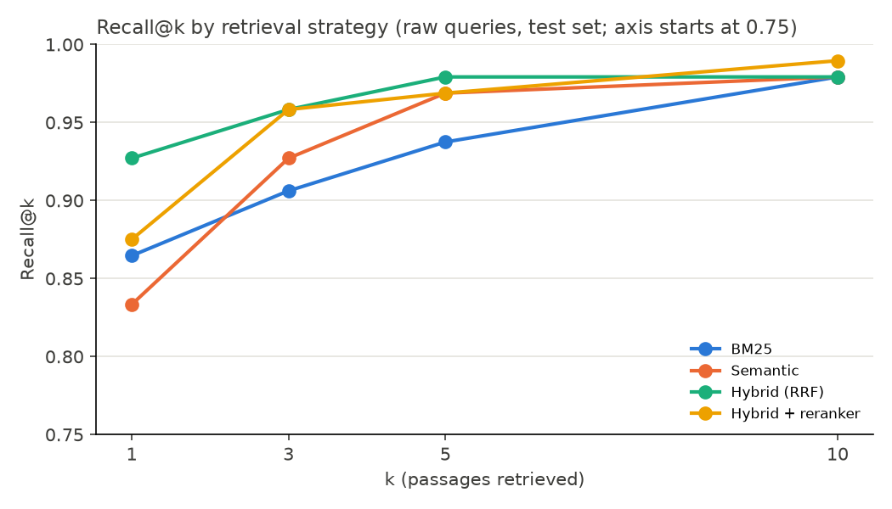
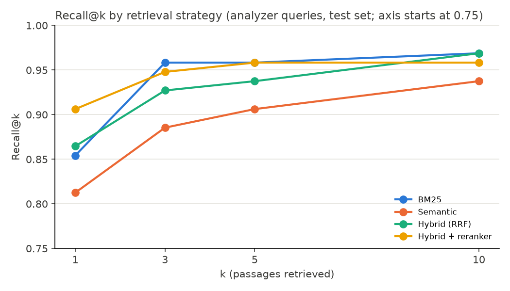
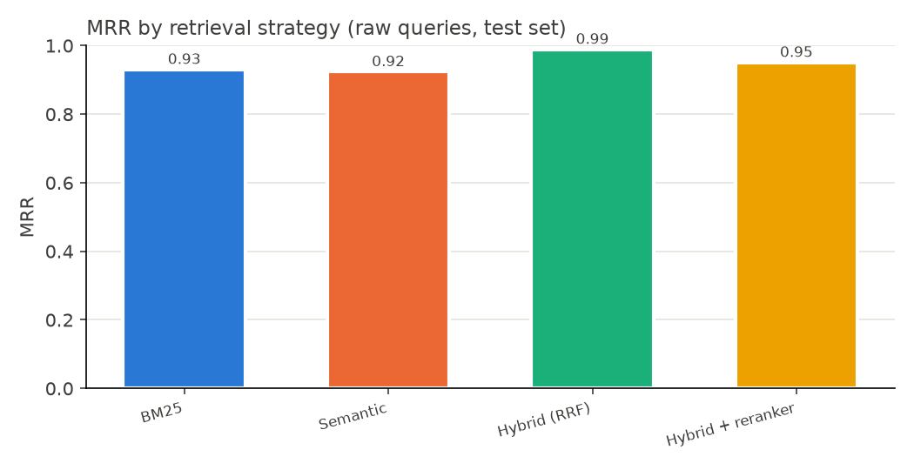

# Benchmark results

Generated by `python -m evaluation.make_report` from the files in `evaluation/results/`. All numbers come from real runs.

## Retrieval

Test set: 48 answerable incidents. Relevance is judged at document level. Embedding model `sentence-transformers/all-MiniLM-L6-v2`, reranker `cross-encoder/ms-marco-MiniLM-L6-v2`, RRF k=60. Run on 2026-11-02 17:23.

| Queries | Strategy | Recall@1 | Recall@3 | Recall@5 | Recall@10 | MRR | Precision@5 | s/query |
|---|---|---|---|---|---|---|---|---|
| raw | BM25 | 0.865 | 0.906 | 0.938 | 0.979 | 0.931 | 0.758 | 0.08 |
| raw | Semantic | 0.833 | 0.927 | 0.969 | 0.979 | 0.924 | 0.867 | 0.03 |
| raw | Hybrid (RRF) | 0.927 | 0.958 | 0.979 | 0.979 | 0.990 | 0.875 | 0.12 |
| raw | Hybrid + reranker | 0.875 | 0.958 | 0.969 | 0.990 | 0.951 | 0.829 | 2.82 |
| analyzer | BM25 | 0.854 | 0.958 | 0.958 | 0.969 | 0.931 | 0.825 | 0.18 |
| analyzer | Semantic | 0.812 | 0.885 | 0.906 | 0.938 | 0.899 | 0.846 | 0.20 |
| analyzer | Hybrid (RRF) | 0.865 | 0.927 | 0.938 | 0.969 | 0.941 | 0.879 | 0.68 |
| analyzer | Hybrid + reranker | 0.906 | 0.948 | 0.958 | 0.958 | 0.965 | 0.879 | 3.15 |
| raw | Semantic, fine-tuned | 0.875 | 0.917 | 0.948 | 0.979 | 0.945 | 0.838 | 0.05 |
| raw | Hybrid, fine-tuned | 0.927 | 0.948 | 0.969 | 0.979 | 0.990 | 0.879 | 0.22 |

## Generation results of the earlier configuration - reranker order, evidence rule >= 2 passages >= -0.22

Full LangGraph workflow. Analyzer `openai/gpt-oss-120b`, investigator `openai/gpt-oss-120b`, judge `qwen/qwen3.8-27b`, 53/53 test incidents scored, run on 2026-11-03 02:44. Answer status counts: {'ok': 38, 'needs_clarification': 1, 'insufficient_evidence': 14}. Mean time per question: 16.9 s.

| Metric | Mean | Questions |
|---|---|---|
| correctness | 0.830 | 47 |
| faithfulness | 0.584 | 47 |
| context_relevance | 0.709 | 51 |
| citation_validity | 1.000 | 48 |
| source_match | 0.927 | 46 |

### Abstention results of the earlier configuration (deterministic, from the cached answers)

- Out-of-scope incidents correctly reported as not covered: 100% (5 questions).
- Answerable incidents where the assistant abstained anyway (false abstention): 27% of 48. Status insufficient_evidence: k8s-005, k8s-008, net-004, net-007, net-008, docker-005, gitlab-003, ansible-002, sre-002; needs_clarification: sre-001.

## Generation results of the final system - RRF order, evidence rule tuned on the validation set, stricter citations

Full LangGraph workflow. Analyzer `openai/gpt-oss-120b`, investigator `openai/gpt-oss-120b`, judge `qwen/qwen3.8-27b`, 53/53 test incidents scored, run on 2026-11-05 17:58. Answer status counts: {'ok': 39, 'insufficient_evidence': 12, 'needs_clarification': 2}. Mean time per question: 20.1 s.

| Metric | Mean | Questions |
|---|---|---|
| correctness | 0.895 | 46 |
| faithfulness | 0.679 | 47 |
| context_relevance | 0.660 | 51 |
| citation_validity | 1.000 | 47 |
| source_match | 0.907 | 45 |

### Abstention results of the final system (deterministic, from the cached answers)

- Out-of-scope incidents correctly reported as not covered: 100% (5 questions).
- Answerable incidents where the assistant abstained anyway (false abstention): 25% of 48. Status insufficient_evidence: k8s-008, net-004, net-007, net-008, docker-005, ansible-002, sre-002; needs_clarification: sre-001, k8s-011.

## Evidence check tuned on a validation set (separate from the test set)

70 validation questions (50 answerable, 20 out-of-scope). Rule: evidence is sufficient when at least N of the 6 passages score >= s.

| Rule | Validation: answerable accepted | Validation: out-of-scope rejected | Test (offline check): answerable accepted | Test (offline check): out-of-scope rejected |
|---|---|---|---|---|
| v1_rule: reranker >= -0.22, N=2 | 0.88 | 1.00 | 0.77 | 1.00 |
| best_reranker_rule: reranker >= -2.86, N=3 | 0.92 | 1.00 | 0.83 | 1.00 |
| best_cosine_rule: cosine >= 0.43, N=2 | 1.00 | 0.95 | 0.92 | 0.60 |

## Fine-tuned vs base embeddings on the evaluation set (raw queries, paired)

| Strategy | MRR base | MRR fine-tuned | Difference | 95% bootstrap CI | Improved / degraded / unchanged |
|---|---|---|---|---|---|
| semantic | 0.924 | 0.945 | +0.021 | [-0.024, +0.067] | 4 / 2 / 42 |
| hybrid | 0.990 | 0.990 | +0.000 | [-0.031, +0.031] | 1 / 1 / 46 |

## Evidence threshold calibration

10 calibration questions, 60 passages. Best reranker threshold -0.22 (balanced accuracy 0.71, TPR 0.92, TNR 0.5).

## Fine-tuning (validation split of the generated pairs)

499 training pairs, 58 validation pairs, 18.9 min on cpu.

| Metric | Before | After |
|---|---|---|
| val_cosine_accuracy@1 | 0.2759 | 0.3276 |
| val_cosine_accuracy@5 | 0.6207 | 0.6207 |
| val_cosine_mrr@10 | 0.4177 | 0.4689 |
| val_cosine_ndcg@10 | 0.5102 | 0.5566 |
